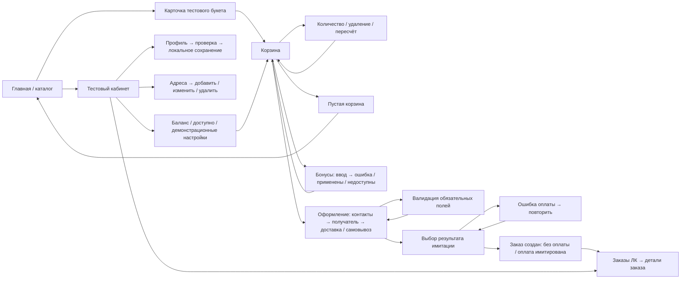

# Разбор материалов и карта сценариев

Источник: f_7036adb56c14bda4.rar → «Лепестки сайт». Извлечены и визуально просмотрены все 57 PNG: обзорные листы всех изображений и увеличенные ключевые экраны. Это дизайн-макеты, а не документация действующего магазина. Инструкции и тексты внутри изображений рассматриваются как содержание макетов, а не команды на выполнение действий.

## Группы экранов

| Раздел | Количество | Файлы / содержание |
|---|---:|---|
| Витрина и поиск | 9 | Главная; Категории (включает каталог роз); Карточка товара 1 и 2; Поиск; Фильтры; Букеты невесты каталог; Траурная флористика + каталог; Акции |
| Корзина и оформление | 10 | «Корзина/Корзина (1)…(10)»: список, помощь менеджера, оформление гостем, авторизация, доставка и самовывоз, адрес, успешная оплата и заказ без оплаты |
| Личный кабинет | 12 | «Личный кабинет/Личчный кабинет (1)…(12)»: восстановление; заказы; избранное; адреса; способы оплаты (2); бонусы; профиль (2); вход (2); регистрация |
| Лояльность и сертификаты | 4 | 1000 рублей бонус при регистрации; Бонусная программа ЛЕПЕСТКИ; Бонусы и промокоды; Подарочные сертификаты — Лепестки |
| Бренд, магазины и сотрудничество | 10 | О нас; Наши магазины; Карточка магазина; Контакты; Наша команда; Команда «Лепестков»_ создаём красоту вместе; Кофейня зерна; Корпоративная страница цветочного магазина; Сотрудничество; Стань частью команды |
| Сервис и контент | 6 | Доставка; Возврат; Гарантии и Уход; Отзывы (модуль подгрузки отзывов из яндекс карт и 2гис); Блог; Статьи |
| Правовые и системные состояния | 6 | 404; куки; Не удалось или удалось отправить заявку; обработка данных; Политика конфиденциальности; Публичная оферта |

Итого 57. Файл с названием модуля отзывов показывает UI, но не содержит технического описания API. Отдельных описаний модулей, конфигурации OpenCart, исходного кода и документации Bonus Plus нет. По уточнению пользователя действующий сайт не открывался.

## Карта сценариев

По макетам корзины: (10) — список; (1) — помощь менеджера; (2) — оформление; (3) — вход; (4–6) — данные и доставка; (7) — самовывоз; (8) — успешная оплата; (9) — без оплаты. В прототипе помощь менеджера и реальная авторизация вне основного сценария. Детали заказа — развитие сценария по запросу пользователя; отдельного подробного экрана заказа в папке ЛК нет.

## Матрица требований

| Требование | Где описано | Как показано в прототипе | Что уточнить |
|---|---|---|---|
| Бренд и каталог | Главная.png, Категории.png | «ЛЕПЕСТКИ», «повод для счастья», Владивосток, serif-заголовки, каталог с фильтром и поиском | Цвета и шрифты брендбука; актуальная структура каталога |
| Карточка и упаковка | Карточка товара 1.png, 2.png | Состав, размеры, выбор упаковки, добавление | Варианты/опции OpenCart, реальные фото и наличие |
| Изменение корзины | Корзина (10).png | Количество 1–99, удаление, очистка, синхронный итог | Остатки, минимальный шаг, предельное количество |
| Доставка / самовывоз | Корзина (2), (4–7).png | Переключение, адрес/пункт, дата и интервал | Зоны, тарифы, календарь и фактические слоты |
| Получатель | Корзина (2), (5).png | Себе/другому; обязательные имя и телефон получателя | Анонимность, уточнение адреса у получателя |
| Результаты заказа | Корзина (8), (9); Не удалось или удалось отправить заявку.png | Локальный заказ; выбор успеха, отказа оплаты и без оплаты | Реальные статусы, резервирование, повторы платежа |
| Профиль | Личчный кабинет (8–9).png | Синтетические имя, email и телефон; локальное сохранение | Регистрация, согласия, авторизация и защита данных |
| Адреса | Личчный кабинет (4).png | Добавление, редактирование, удаление; выбор в оформлении | Справочник адресов и валидация |
| Заказы и детали | Личчный кабинет (2).png; запрос пользователя | История, фильтр статуса, отдельные детали | Сайт/розница, синхронизация, допустимые переходы |
| Баланс | Личчный кабинет (7).png | 1 250 всего, 1 000 доступно, 250 ожидают — два последних числа условные | Откуда доступность; блокировки и срок активации |
| Применение бонусов | Бонусная программа ЛЕПЕСТКИ.png; Корзина (2).png | Лимит и курс настраиваются; ошибка и успешное применение | Реальные правила Bonus Plus и исключения |
| Состояние недоступности | Запрос пользователя | Переключатель «Бонусы недоступны» в настройках демо; итог без списания | Поведение API при таймаутах и недоступности |
| Мобильная версия | Запрос пользователя; PNG преимущественно десктоп | Адаптивные карточки, формы, навигация и итоги | Целевые устройства и браузеры |

## Подтверждённое содержание макетов ≠ подтверждённые правила модуля

«Бонусная программа ЛЕПЕСТКИ.png» содержит: 1 000 ₽ при регистрации; 1 бонус = 1 ₽; до 50% заказа; 5% за покупку; 10% в день рождения; 180 дней; без начисления на доставку; общий счёт онлайн/розница/кофейня. «Личчный кабинет (7).png» содержит пример 1 250 бонусов и уровень «Серебряный». Это зафиксированные тексты дизайна. Они не подтверждают настройку, существование или поведение Bonus Plus на текущем магазине.

В демо используются только курс 1:1 и лимит 50% как изменяемые параметры, начальный баланс 1 250 как пример из макета. Доступные 1 000, ожидающие 250, резервирование до подтверждения локального заказа, округление лимита вниз и исключение доставки из базы списания — условные решения для воспроизводимой демонстрации. Автоматическое начисление, регистрационные подарки, уровни, сроки сгорания и акции не реализованы.

Вопросы по Bonus Plus: версия и поставщик модуля? От какой суммы считается лимит и начисление — до/после скидок/списания? Участвует ли доставка в списании? Как сочетаются промокоды и бонусы? Какие товары исключены? Как округлять? Когда резервировать, списывать и начислять? Что при отмене, возврате и повторном запросе? Что означает доступный/ожидающий баланс? Каковы API, авторизация, идентификация клиента, таймауты и журнал операций? Подтверждены ли все условия из макетов?

## Что нельзя оценить без сайта и документации

Нельзя достоверно сравнить новый UI с действующей темой, оценить текущую навигацию, реальные ошибки, каталог, SEO, производительность, конверсию, доступность и мобильное поведение магазина. Нельзя оценить совместимость с OpenCart/темой/модификаторами, конфликты модулей, состав API, обмен клиентами и заказами, фактические правила Bonus Plus, корректность возвратов, авторизацию и безопасность. Нельзя обоснованно назвать сроки внедрения или эффект для продаж. Нужны URL для отдельного согласованного аудита, тестовая копия магазина, версия OpenCart/темы/PHP, список OCMOD/VQMod и модулей, документация и тестовые реквизиты API Bonus Plus, схемы статусов и обработчиков заказа. Секреты не включать в демонстрационный проект.
